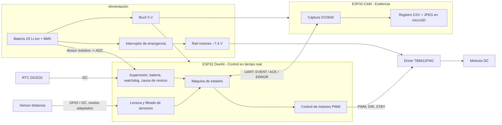
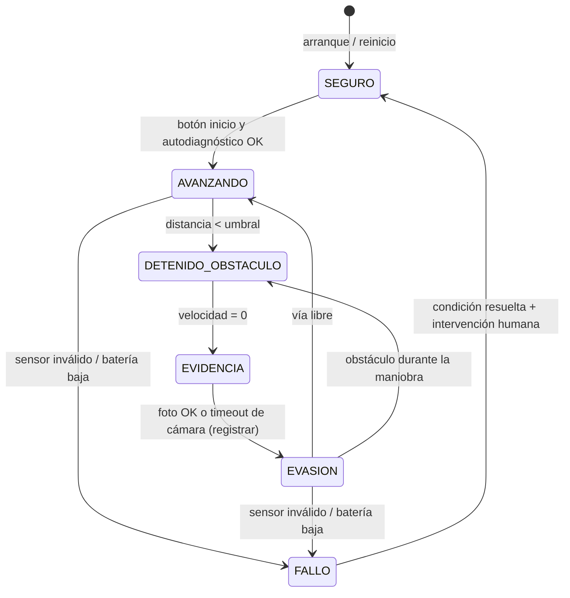

# Teslaneitor — Fase 0: Propuesta inicial

> Estado: **BORRADOR, pendiente de aprobación.** Nada en este documento está validado físicamente ni en simulación.
> Todas las especificaciones de componentes marcadas con *(verificar)* deben confirmarse en el datasheet del fabricante antes de la Fase 4.
> Fecha: 2026-10-26

> **Actualización:** las secciones 3 (matriz de hardware) y 4 (arquitectura) están **sustituidas** por `fase-1-integracion-kit.md` (D-04: Uno del kit + ESP32-CAM, L298N, NiMH) y `fase-3-arquitectura.md`. Los requisitos (sección 2) y los riesgos (sección 5) siguen vigentes.

## 0. Estado del directorio de trabajo

| Elemento | Estado |
|---|---|
| Rama `develop` | Sin commits |
| `README.md` | Vacío |
| `electronics/bom.csv` | Vacío |
| `references/bibliography.md` | Vacío |

Conclusión: el proyecto parte de cero. No hay decisiones previas que respetar.

---

## 1. Alcance propuesto para la versión 1 (MVP)

**Dentro del alcance (v1):**

- Chasis de 2 ruedas motrices + rueda loca (o kit 4WD), motores DC con reductora.
- Movimiento autónomo simple: avanzar en línea recta; al detectar obstáculo, **detenerse**, fotografiar, registrar y luego girar para buscar un camino libre.
- Un sensor de distancia frontal (posible ampliación a 3 sensores en v1.1).
- Captura de una foto JPEG por evento, guardada en microSD.
- Registro de eventos (CSV en microSD): fecha/hora, distancia, estado del vehículo, nombre del archivo de foto, código de error.
- Supervisión de batería y respuesta segura ante fallos (sensor, cámara, batería, reinicio).
- Parada de emergencia física (interruptor) independiente del software.

**Fuera del alcance (v1):**

- Reconocimiento de objetos con IA.
- Navegación por mapa, SLAM, odometría precisa con encoders.
- Control remoto por app (solo, como mucho, una página web de diagnóstico si sobra tiempo).
- PCB a medida (v1 usa protoboard/placa perforada; PCB en KiCad queda como objetivo de la Fase 5 si hay tiempo y presupuesto).

**Por qué así:** el núcleo del proyecto es la cadena *detectar → detener → evidenciar → registrar* con seguridad ante fallos. Todo lo demás es complejidad que no aporta a esa cadena.

---

## 2. Requisitos

Cada requisito tiene un método de verificación: **P** = prueba física, **S** = simulación, **I** = inspección/revisión, **A** = análisis/cálculo.

### 2.1 Funcionales

| ID | Requisito | Verificación |
|---|---|---|
| RF-01 | El vehículo avanza de forma autónoma sin intervención humana tras pulsar "inicio". | P |
| RF-02 | Mide la distancia frontal a obstáculos entre 5 cm y 150 cm *(rango a confirmar según sensor)*. | P, S |
| RF-03 | Se detiene sin contacto cuando un obstáculo entra en la zona de seguridad (umbral propuesto: 25 cm, configurable). | P |
| RF-04 | Captura una foto en ≤ 1 s desde la detección. | P |
| RF-05 | Registra cada evento con: fecha y hora, distancia medida (cm), estado del vehículo, archivo de foto, código de resultado. | P, I |
| RF-06 | Tras el evento, ejecuta una maniobra de evasión (retroceder + girar) y reanuda la marcha solo si la vía está libre. | P |
| RF-07 | Ante lectura de distancia inválida (timeout, fuera de rango, N lecturas inconsistentes) el vehículo se detiene. | P, S |
| RF-08 | Si la cámara falla, el vehículo se detiene igualmente y registra el evento con código "sin foto". | P |
| RF-09 | Si la batería baja de un umbral, el vehículo se detiene y registra el evento. | P |
| RF-10 | Tras un reinicio (watchdog o brown-out) los motores arrancan en estado **parado** y se registra la causa del reinicio. | P |
| RF-11 | Un interruptor de emergencia corta la alimentación de los motores físicamente. | P, I |

### 2.2 No funcionales

| ID | Requisito | Verificación |
|---|---|---|
| RNF-01 | Latencia detección → orden de parada ≤ 100 ms. | P (osciloscopio/analizador o marca de tiempo) |
| RNF-02 | Velocidad máxima en v1 ≤ 0,3 m/s (limita la distancia de frenado). | P, A |
| RNF-03 | Autonomía ≥ 20 min de operación continua. | P |
| RNF-04 | Coste total de materiales ≤ *(presupuesto por definir — ver preguntas)*. | I |
| RNF-05 | Ningún GPIO del microcontrolador recibe una tensión mayor que su nivel lógico máximo. | A, I |
| RNF-06 | Alimentación de motores separada de la lógica, con masa común. | I |
| RNF-07 | El firmware es modular y las funciones de decisión (máquina de estados, filtros) tienen pruebas unitarias en el PC. | I, S |
| RNF-08 | Todo el diseño (docs, diagramas Mermaid, BOM, esquemas, código) está versionado en Git. | I |
| RNF-09 | El registro de eventos sobrevive a un corte de alimentación (como mucho se pierde el último evento). | P |

### Concepto clave: ¿por qué 25 cm y 0,3 m/s?

La distancia total que recorre el vehículo desde que el obstáculo cruza el umbral hasta que se detiene es:

```
d_total = v · (t_medición + t_procesado) + d_frenado
```

Con v = 0,3 m/s, un periodo de medida de 60 ms (típico en ultrasonidos para evitar ecos del ciclo anterior *(verificar)*) y ~10 ms de procesado: 0,3 · 0,07 ≈ 2 cm. La distancia de frenado de un robot pequeño con motores DC suele ser de unos pocos cm, pero **hay que medirla** (Fase 9). Con 25 cm quedaría un margen amplio; el umbral se ajustará con datos reales.

---

## 3. Matriz de alternativas de hardware

> Los costes son **orientativos y por verificar** (rangos típicos en tiendas de electrónica online, en USD). Las especificaciones marcadas *(verificar)* se confirmarán con el datasheet.

### 3.1 Unidad de control y cámara (la decisión más importante)

| Opción | Ventajas | Desventajas | Coste aprox. | Complejidad |
|---|---|---|---|---|
| **A. ESP32-CAM sola** | Muy barata; cámara OV2640 y ranura microSD integradas; Wi-Fi. | Muy pocos GPIO libres (la cámara y la SD ocupan casi todos); sin USB nativo (requiere adaptador); conocida por problemas de alimentación (picos de corriente con Wi-Fi). Difícil manejar motores + sensores + batería con los pines restantes. | 8–12 | Media-alta (por la falta de pines) |
| **B. ESP32 DevKit (control) + ESP32-CAM (cámara + SD), unidas por UART** | Separa lo crítico (parar) de lo no crítico (foto): si la cámara se cuelga, el control sigue parando. GPIO suficientes. Ambas programables con el mismo entorno. | Dos firmwares; protocolo UART que diseñar; dos placas que alimentar. | 15–22 | Media |
| **C. Raspberry Pi Zero 2 W + cámara + microcontrolador para motores** | Linux: fotos de alta calidad, almacenamiento fácil, reloj por NTP, puerta abierta a IA futura. | Arranque lento (decenas de segundos); Linux no es tiempo real; consumo mayor; corrupción de SD si se corta la alimentación; disponibilidad/precio variables. | 35–60 | Alta |
| **D. Raspberry Pi Pico (W) + módulo cámara SPI (p. ej. ArduCAM)** | Pico es barata y bien documentada; tiempo real fiable. | El módulo cámara SPI encarece y tiene menos ejemplos; Pico sin cámara nativa. | 25–40 | Media-alta |

**Recomendación preliminar: opción B.** Razón principal: la seguridad (parar) no debe depender de la parte más frágil del sistema (cámara + SD). Pendiente de tu aprobación.

### 3.2 Sensor de distancia

| Opción | Ventajas | Desventajas | Coste aprox. | Complejidad |
|---|---|---|---|---|
| **HC-SR04 (ultrasonido)** | Muy barato y documentado; ~2–400 cm *(verificar)*; inmune a la luz. | Alimentación 5 V y pin ECHO de 5 V → **necesita divisor de tensión** para un ESP32 (3,3 V, no tolerante a 5 V). Cono ancho; falla con superficies blandas o inclinadas. Existen variantes 3,3 V (HC-SR04P / RCWL-1601) *(verificar)*. | 1–3 | Baja |
| **VL53L0X / VL53L1X (ToF láser, I2C)** | Haz estrecho, preciso, 3,3 V, I2C. | Falla con superficies muy oscuras/reflectantes y con luz solar intensa; rango ~1–2 m según modelo *(verificar)*; varios sensores requieren cambiar direcciones I2C (pin XSHUT). | 4–10 | Media |
| **Sharp GP2Y0A21 (IR analógico)** | Salida analógica simple. | No lineal; zona muerta cerca; ruido; ADC del ESP32 poco lineal. | 8–12 | Media |

**Recomendación preliminar:** HC-SR04 (o su variante 3,3 V) para v1; considerar añadir un VL53L0X como segundo sensor redundante (detecta lo que el ultrasonido no ve y viceversa).

### 3.3 Driver de motores

| Opción | Ventajas | Desventajas | Coste aprox. | Complejidad |
|---|---|---|---|---|
| **L298N** | Muy común, robusto, con borneras. | Tecnología bipolar: caída de ~2 V *(verificar)* → desperdicia batería y calienta; voluminoso. | 2–5 | Baja |
| **TB6612FNG** | MOSFET: poca caída, eficiente; ~1,2 A continuos por canal *(verificar)*; lógica 3,3 V compatible; pin STBY útil para parada segura. | Módulo pequeño (soldar pines); límite de tensión de motor más bajo (~13,5 V *(verificar)*). | 3–7 | Baja |
| **DRV8833** | Muy pequeño y eficiente. | Tensión máx. ~10,8 V *(verificar)*; menos corriente. | 2–5 | Baja |

**Recomendación preliminar:** TB6612FNG (eficiencia y pin STBY para un estado seguro por hardware).

### 3.4 Alimentación

| Opción | Ventajas | Desventajas | Coste aprox. | Complejidad |
|---|---|---|---|---|
| **2× 18650 Li-ion (2S, ~7,4 V) + reductor buck a 5 V** | Buena autonomía; recargables; corriente alta. | Requiere BMS/protección y cargador adecuado; riesgo si se maltratan. | 10–20 | Media |
| **Pack 4–6× AA NiMH** | Seguro y simple. | Más peso, menos energía, tensión cae con la descarga. | 8–15 | Baja |
| **Powerbank USB (lógica) + pack aparte (motores)** | Separación total y trivial de alimentaciones. | Algunos powerbanks se apagan con poco consumo; dos cargas que gestionar. | 10–20 | Baja |

**Recomendación preliminar:** 2S 18650 con BMS → motores directamente; buck → 5 V para la lógica, con condensadores de desacoplo cerca de cada placa.

### 3.5 Marca de tiempo (fecha y hora)

| Opción | Ventajas | Desventajas | Coste aprox. |
|---|---|---|---|
| **NTP por Wi-Fi** | Gratis, preciso. | Requiere Wi-Fi disponible en el entorno de pruebas. | 0 |
| **RTC DS3231 (I2C, con pila)** | Funciona sin red; mantiene hora tras cortes. | Módulo extra. | 2–5 |
| **Tiempo desde el arranque** | Trivial. | No es fecha/hora real. | 0 |

**Recomendación preliminar:** DS3231 (no dependemos de la red del laboratorio), sincronizable por NTP cuando haya Wi-Fi.

---

## 4. Arquitectura preliminar (basada en la opción B)



> Nota: todas las masas (batería, buck, driver, ambas placas) se unen en un punto común. Sin masa común, las señales PWM/UART no tienen una referencia y el sistema se comporta de forma errática.

### Máquina de estados del control (preliminar)



**Concepto clave — "fail-safe":** el estado por defecto, tras cualquier duda (reinicio, lectura inválida, cámara colgada), es *motores parados*. Por hardware, el pin STBY del driver con resistencia de pull-down garantiza que, mientras el ESP32 arranca y sus pines flotan, los motores no se muevan.

---

## 5. Registro inicial de riesgos

Probabilidad (P) e impacto (I): B = bajo, M = medio, A = alto.

| ID | Riesgo | P | I | Mitigación |
|---|---|---|---|---|
| R-01 | Picos de corriente de motores provocan brown-out/reinicio del ESP32. | A | A | Rails separados, buck dimensionado, condensadores electrolíticos + cerámicos, cableado corto de motores, masa en estrella. |
| R-02 | Pin ECHO de 5 V daña el GPIO del ESP32 (3,3 V). | M | A | Divisor de tensión o sensor de 3,3 V; verificar con multímetro antes de conectar. |
| R-03 | El ultrasonido no detecta obstáculos blandos, inclinados o finos. **Confirmado por el datasheet: el objeto debe medir ≥ 0,5 m² y ser liso** (fase 2, H2). | A | A | Obstáculos de prueba grandes y lisos; documentarlo como limitación de la v1; sensor redundante en v1.1; velocidad limitada. |
| R-04 | La ESP32-CAM es inestable (alimentación, SD, calor). | A | M | Alimentación 5 V dedicada con buen condensador; el control no depende de ella; timeout de captura. |
| R-05 | Corrupción del archivo de registro en la microSD por corte de energía. | M | M | Escribir y hacer `flush` por evento; formato de líneas independiente (CSV); verificación al arrancar. |
| R-06 | Mal uso de baterías Li-ion (sobrecarga, cortocircuito). | B | A | BMS, fusible, cargador específico, nunca cargar sin supervisión. |
| R-07 | Distancia de frenado mayor de lo estimado → contacto con el obstáculo. | M | M | Medir en Fase 9; limitar velocidad; frenado activo (cortocircuito de motor vía driver). |
| R-08 | Pines del ESP32 con funciones de arranque (*strapping pins*) causan comportamiento extraño al arrancar. | M | M | Asignar pines consultando la documentación del ESP32 de Espressif; no usarlos para motores. |
| R-09 | Plazos del semestre insuficientes. | M | A | MVP pequeño; fases con entregables; lo opcional se marca como opcional. |
| R-10 | Componentes falsificados o clones con especificaciones distintas. | M | M | Comprar en proveedores fiables; probar cada módulo por separado antes de integrar. |
| R-11 | Simulación (Wokwi) no refleja el comportamiento real (ruido, corrientes). | A | B | Usar simulación solo para lógica; validar lo eléctrico en el banco. |
| R-13 | Al retroceder durante la evasión no hay sensor trasero → posible choque. | M | B | Retroceso corto (~10 cm) y a velocidad baja. |
| R-14 | El bootloader de algunos clones del Uno entra en un bucle de reinicios al usar el watchdog. | M | M | Probarlo en T0 con un programa de prueba; si falla, regrabar el bootloader Optiboot o no usar el watchdog. |
| R-15 | Pulso del ECHO medido con error si llegan datos por SoftwareSerial a la vez (las interrupciones alargan el bucle de medida). | B | B | El error hace parecer el obstáculo **más cerca** (dirección segura); los mensajes llegan con el robot parado. |
| R-12 | Falsos contactos de la protoboard con la vibración del vehículo → reinicios o lecturas erráticas. | A | M | Cables cortos y fijados; potencia fuera de la protoboard; pasar a placa perforada soldada si aparecen fallos intermitentes. |

---

## 6. Preguntas pendientes (pueden cambiar el diseño)

1. **Presupuesto** máximo total.
2. **Plazo**: fecha de entrega y fechas de revisión intermedias del curso.
3. **Microcontrolador**: ¿el curso exige o recomienda alguno (Arduino, ESP32, PIC, STM32, Raspberry Pi)?
4. **Lenguaje/entorno**: ¿Arduino framework, ESP-IDF, MicroPython, C puro? ¿Se evalúa el uso de RTOS?
5. **Material disponible**: ¿ya tienes chasis, motores, sensores, baterías, soldador, multímetro, osciloscopio?
6. **Entorno de pruebas**: superficie, tamaño del área, iluminación, tipo de obstáculos (cajas, paredes, personas, objetos finos).
7. **Wi-Fi**: ¿hay red disponible en el lugar de pruebas? (afecta a NTP y a la descarga de fotos).
8. **Fotos**: ¿qué calidad/resolución se espera? ¿basta con guardarlas en SD o deben verse en tiempo real?
9. **PCB**: ¿es obligatorio fabricar una PCB o basta con protoboard/placa perforada?
10. **Equipo**: ¿trabajas solo o en grupo? ¿quién revisa/aprueba?
11. **Requisitos de evaluación**: ¿hay rúbrica (informe, presentación, demo, código)?
12. **Seguridad de baterías**: ¿el laboratorio permite Li-ion?

---

## 7. Plan de fases

| Fase | Entregables | Criterios de aceptación |
|---|---|---|
| 1. Requisitos | `docs/requisitos.md` con requisitos numerados y método de verificación. | Aprobados por ti; cada requisito es medible. |
| 2. Investigación | Matrices de alternativas completadas con datasheets citados en `references/bibliography.md`. | Cada valor crítico (tensión, corriente, nivel lógico) tiene fuente primaria. |
| 3. Arquitectura | Diagramas Mermaid (bloques, estados, secuencia UART); asignación preliminar de pines. | Sin conflictos de pines ni niveles lógicos; revisado contra requisitos. |
| 4. Selección de componentes | `electronics/bom.csv` con referencia, proveedor, precio, enlace al datasheet; registro de decisiones (ADR). | Presupuesto de potencia calculado; coste ≤ presupuesto; **tu aprobación antes de comprar**. |
| 5. Diseño electrónico y mecánico | Esquema en KiCad (ERC sin errores); modelo FreeCAD del soporte de sensores/placas. | ERC limpio; revisión de niveles y corrientes; piezas imprimibles/montables. |
| 6. Diseño de firmware | Documento de diseño: módulos, máquina de estados, protocolo UART, formato de log. | Trazabilidad requisito → módulo; casos de fallo cubiertos. |
| 7. Simulación y pruebas unitarias | Pruebas unitarias en PC de la lógica (máquina de estados, filtros); simulación Wokwi de la lógica de sensado. | Todas las pruebas pasan; cada RF de lógica tiene al menos una prueba. |
| 8. Integración | Prototipo montado por etapas: alimentación → motores → sensor → cámara → registro. | Cada etapa probada antes de la siguiente; checklist de banco firmado. |
| 9. Validación experimental | Plan y resultados de pruebas (distancia de frenado, latencia, autonomía, inyección de fallos). | Todos los RF/RNF con evidencia (datos, fotos, vídeo); los fallos se documentan, no se ocultan. |
| 10. Documentación final | README, informe, presentación, vídeo de demostración. | Documentos, BOM, esquemas y código coherentes entre sí. |

---

## Registro de decisiones

| ID | Fecha | Decisión | Motivo |
|---|---|---|---|
| D-01 | 2026-10-26 | Arquitectura B: ESP32 DevKit (control) + ESP32-CAM (cámara + SD) por UART. | Aprobada por el usuario; aísla la parada de los fallos de la cámara. **Sustituida por D-04** (Arduino Uno del kit + ESP32-CAM), ver `fase-1-integracion-kit.md`. |
| D-02 | 2026-10-26 | Sin PCB en v1: montaje en placa de pruebas (protoboard). | No es obligatoria. Los cables de potencia de los motores y la batería no pasarán por la protoboard (sus contactos no aguantan bien la corriente de los motores); irán con bornas o soldados. |
| D-03 | 2026-10-26 | Hora por NTP (hay Wi-Fi); el RTC DS3231 pasa a ser opcional. | Hay Wi-Fi en el lugar de pruebas. Riesgo: si la red falla al arrancar no hay hora real → se registra el tiempo desde el arranque con un indicador "sin hora". |

**Material disponible:** multímetro. El kit (chasis, motores, Uno, L298N, HC-SR04) **está en camino** (2026-10-26); hasta que llegue, todo se diseña en papel. Sin osciloscopio → la latencia (RNF-01) se medirá con marcas de tiempo en el firmware.

## Pendiente de aprobación / respuesta

1. Alcance v1 (sección 1).
2. Umbral de seguridad inicial de 25 cm y velocidad máxima de 0,3 m/s.
3. Presupuesto y fecha de entrega.
4. ¿Se permiten baterías Li-ion en el laboratorio?
5. Datos de los motores y del chasis (modelo, tensión nominal, nº de motores) — determinan el driver y la batería.
