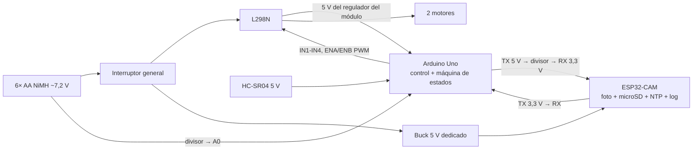

# Teslaneitor — Integración del kit base y de la cámara

> Estado: **BORRADOR, pendiente de aprobación.** Nada está validado físicamente.
> Fecha: 2026-10-26
>
> Leyenda de certeza usada en todo el documento:
> - **[KIT]** — dato proporcionado por el usuario (descripción del kit).
> - **[VERIFICAR]** — especificación conocida de forma general que debe confirmarse en el datasheet o con el multímetro.
> - **[SUPUESTO]** — hipótesis de diseño sin evidencia todavía.

---

## 1. Recursos del fabricante: estado del análisis

**No he podido analizarlos.** El código, los diagramas y los vídeos están detrás del código QR del paquete y no tengo acceso a ellos. Por eso:

- La asignación de pines de la sección 3 es **[SUPUESTO]**: es la habitual en kits de este tipo, no la de tu kit.
- Acción necesaria: descarga el código de ejemplo y el diagrama de conexiones a `references/vendor/` (o pásame el enlace) y rehago la sección 3 con datos reales.

### Qué esperamos poder reutilizar (a confirmar con el código)

| Función original | ¿Reutilizable en Teslaneitor? | Comentario |
|---|---|---|
| Control de motores (L298N, adelante/atrás/giro) | **Sí** | Base directa del módulo de motores. |
| Lectura del HC-SR04 | **Sí** | Base del sensado, pero hay que añadir detección de lecturas inválidas (timeout = sin eco). |
| Evasor de obstáculos | **Parcial** | La lógica suele ser bloqueante (`delay()`); se reescribirá como máquina de estados no bloqueante. Sirve como referencia y como **prueba de humo** del montaje. |
| Siguelíneas (TCRT5000) | No en v1 | Los sensores pueden quedar desconectados o usarse como detector de borde de mesa (opcional). |
| Sumo / pala | No | La pala sobresale por delante y puede tapar el HC-SR04 o la cámara: **desmontarla**. |
| Bluetooth HC-06 + app Android | No en v1 | Ocupa un puerto serie que necesitamos para la cámara (ver sección 4). La ESP32-CAM ya aporta Wi-Fi para diagnóstico. |

---

## 2. Inventario: incluido vs. por comprar

### Incluido en el kit [KIT]

Arduino Uno R3 (CH340), L298N, 2 motorreductores 1:48, 2 ruedas 65 × 25 mm, rueda loca, 2 TCRT5000, HC-SR04, HC-06/BT-04, chasis de acrílico, pala, portapilas 6 AA, tornillería y cables.

### Por comprar (propuesta, precios [VERIFICAR])

Ver `electronics/bom.csv`. Resumen: ESP32-CAM + programador USB, microSD, convertidor buck a 5 V, interruptor, resistencias, condensadores y 6 pilas AA NiMH con cargador (si no las tienes). Estimación total: **≈ 20–35 USD**.

---

## 3. Especificaciones relevantes

| Elemento | Dato | Certeza | Consecuencia de diseño |
|---|---|---|---|
| Arduino Uno (ATmega328P) | Lógica 5 V; 2 KB de SRAM; 32 KB de flash; **un solo UART hardware** (D0/D1, compartido con el USB) | [VERIFICAR] datasheet ATmega328P | 2 KB de SRAM descarta manejar imágenes en el Uno. Un único UART obliga a elegir entre Bluetooth y cámara, o usar SoftwareSerial. |
| Pines PWM del Uno | D3, D5, D6, D9, D10, D11 | [VERIFICAR] | ENA/ENB del L298N deben ir a pines PWM. |
| HC-SR04 | 5 V; pulso de eco proporcional a la distancia | [VERIFICAR] | **Compatible directo con el Uno** (ambos a 5 V). Es una ventaja de mantener el Uno. |
| L298N | Caída de ~2 V entre la alimentación y el motor; regulador de 5 V en el módulo con puente "5V EN" | [VERIFICAR] datasheet ST L298 | Con pilas AA el motor recibe bastante menos tensión que el portapilas. |
| Motorreductor 1:48 ("TT") | Nominal típico 3–6 V; ~100–250 rpm según el modelo | [SUPUESTO] — no hay modelo concreto | Hay que **medir** la velocidad real (prueba T2). |
| Ruedas | Ø 65 mm → perímetro ≈ 0,204 m | [KIT] + cálculo | A 200 rpm serían ≈ 0,68 m/s → limitar el PWM para no pasar de 0,3 m/s. |
| 6 AA | Alcalinas: 9 V nominal (≈ 9,6 V nuevas); NiMH: 7,2 V | [VERIFICAR] | **Recomiendo NiMH**: aguantan mejor los picos de corriente. Con este portapilas ya no necesitamos Li-ion. |
| ESP32-CAM (AI-Thinker) | Lógica **3,3 V, NO tolerante a 5 V**; alimentación por el pin de 5 V; picos de corriente altos con el Wi-Fi; UART0 en GPIO1/GPIO3, compartido con la programación | [VERIFICAR] Espressif + esquema de AI-Thinker | Exige adaptar el nivel del TX del Uno y darle una alimentación propia. |

---

## 4. Comparación de opciones de cámara

| Opción | Reutiliza el kit | Ventajas | Desventajas | Coste extra [VERIFICAR] | Complejidad |
|---|---|---|---|---|---|
| **A. Uno (control) + ESP32-CAM (foto, SD, hora NTP, registro)** | Todo salvo el Bluetooth | Coste mínimo; el HC-SR04 y el L298N siguen a 5 V sin cambios; la parada no depende de la cámara; Wi-Fi para la hora y la descarga de fotos | Adaptar el nivel del UART (5 V → 3,3 V); un segundo firmware; el Bluetooth queda fuera del UART | 12–20 | Media |
| **B. ESP32 DevKit + ESP32-CAM** (decisión D-01 anterior) | Descarta el Uno | Más memoria y velocidad, Wi-Fi en el control | Compra extra; el HC-SR04 necesita adaptar el nivel del eco; **contradice la regla de reutilizar el kit** sin una ganancia necesaria para la v1 | 20–30 | Media |
| **C. Uno + Raspberry Pi + cámara** | Todo | Mejores fotos, Linux | Caro; mucho consumo para 6 AA; arranque lento; la SD se corrompe con cortes de alimentación | 45–80 | Alta |
| **D. Uno + cámara SPI (ArduCAM Mini) + módulo SD** | Todo | Un solo microcontrolador | Más cara que la ESP32-CAM, fotos lentas, SPI compartido, poca documentación actual; la SRAM del Uno queda al límite | 30–45 | Alta |
| **E. Solo ESP32-CAM (sin Uno)** | Casi nada | Una sola placa | Pocos pines libres; la seguridad depende de la parte más frágil | 12–20 | Alta |

### Recomendación: opción A

El Uno basta para medir con el HC-SR04, mover los motores y ejecutar la máquina de estados. La ESP32-CAM hace lo que el Uno no puede: la foto, la SD, la hora por NTP y el Wi-Fi. Esto **modifica la decisión D-01** (ESP32 DevKit → Arduino Uno del kit), así que necesita tu aprobación.

### Arquitectura propuesta (opción A)

Todas las masas van unidas (batería, L298N, buck, Uno, ESP32-CAM).

### Protocolo y almacenamiento (preliminar)

- El Uno envía: `EVT,<distancia_cm>,<estado>\n`.
- La ESP32-CAM toma la foto, la guarda como `/img/AAAAMMDD_HHMMSS.jpg`, añade una línea a `/log.csv` y responde `ACK,<archivo>` o `ERR,<código>`.
- Si no hay respuesta en **1,5 s**, el Uno continúa con el robot **detenido** y marca el evento como "sin foto".
- Descarga de fotos en v1: sacar la microSD. En v1.1, opcionalmente, una página web en la ESP32-CAM.
- **Limitación:** si la ESP32-CAM entera falla, no queda registro en la SD. El Uno solo puede informar por el monitor serie. Lo acepto para la v1 [SUPUESTO — confírmalo].

---

## 5. Modificaciones eléctricas propuestas

> **Corregido en la fase 2** (`fase-2-especificaciones.md`): E1 → el Uno se alimenta por VIN desde la batería (H3); E3 + E4 → un adaptador de nivel BSS138 para TX y RX (H1); E6 → divisor 100k/10k con referencia interna de 1,1 V (H4). El diagrama de la sección 4 está sustituido por el de `fase-3-arquitectura.md`.

| # | Modificación | Motivo |
|---|---|---|
| E1 | Alimentar la ESP32-CAM con un **buck propio** desde la batería, no desde el 5 V del Uno ni del L298N. | Los reguladores del Uno y del L298N son lineales y pequeños. Ejemplo: con 7,2 V de entrada y ~0,3 A de pico, disipan (7,2 − 5) × 0,3 ≈ 0,7 W, y en el Uno la tensión además caería y reiniciaría la placa. [VERIFICAR el consumo de la ESP32-CAM] |
| E2 | Condensador electrolítico (≈ 470 µF) + cerámico de 100 nF en la entrada de 5 V de la ESP32-CAM. | Absorben los picos del Wi-Fi y evitan el brown-out (reinicio por caída de tensión). |
| E3 | **Divisor de tensión** en TX del Uno → RX de la ESP32-CAM (p. ej. 1 kΩ / 2 kΩ → ~3,3 V). | El ESP32 no tolera 5 V. **Medir con el multímetro antes de conectar.** |
| E4 | TX de la ESP32-CAM → RX del Uno directo. | 3,3 V suele leerse como "1" en el Uno (umbral de entrada alta ≈ 0,6·Vcc = 3,0 V) [VERIFICAR]; el margen es pequeño. Si falla, usar un adaptador de nivel. |
| E5 | Resistencias **pull-down de 10 kΩ en ENA y ENB** del L298N, y quitar los puentes de ENA/ENB si los tiene. | Durante el arranque o un reinicio del Uno sus pines quedan "flotando"; con pull-down los motores quedan parados por hardware (estado seguro). |
| E6 | Divisor de batería → A0 (p. ej. 20 kΩ / 10 kΩ: 9,6 V → 3,2 V). | Medir la batería sin superar los 5 V del ADC. |
| E7 | Interruptor general en serie con la batería (si el kit no lo trae). | Parada de emergencia física. |
| E8 | Bluetooth desconectado en la v1. | Libera el UART; si se quiere, más adelante puede ir por SoftwareSerial. |
| E9 | Potencia (batería, motores, L298N) con cables directos, **no por la protoboard**. | Riesgo R-12 (falsos contactos con la vibración). |

**Conflicto a resolver en el diseño detallado:** el UART del Uno (D0/D1) también se usa para cargar el programa por USB. Opciones: desconectar la ESP32-CAM al programar, o usar SoftwareSerial en otros pines para la ESP32-CAM. Lo mismo pasa con GPIO1/GPIO3 de la ESP32-CAM. Lo decidiremos cuando veamos los pines reales del kit.

---

## 6. Plan de pruebas (por etapas; cada una debe pasar antes de la siguiente)

| ID | Prueba | Procedimiento | Criterio de aceptación |
|---|---|---|---|
| T0 | Kit original | Montar según el fabricante, cargar el ejemplo evasor tal cual; medir la batería en reposo y con los motores en marcha. | El robot funciona como describe el fabricante; tensiones anotadas. |
| T1 | HC-SR04 | Obstáculo plano a 10, 25, 50 y 100 cm (cinta métrica), 20 lecturas cada uno; tapar o desconectar el eco. | Error medio ≤ ±2 cm [SUPUESTO, ajustar]; sin eco → se detecta como inválida y nunca se toma por "vía libre". |
| T2 | Motores | Cronometrar 1 m a distintos PWM; medir la distancia de frenado desde 0,3 m/s. | PWM calibrado para ≤ 0,3 m/s; distancia de frenado medida y anotada. |
| T3 | ESP32-CAM sola (USB) | 20 capturas seguidas con hora NTP y línea en el log. | 20/20 correctas; archivos legibles en el PC. |
| T4 | ESP32-CAM con el buck y los motores en marcha | 10 min de motores activos + capturas cada 10 s. | Sin reinicios (contador de arranques en el log). |
| T5 | Enlace UART | Medir RX de la ESP32-CAM con el multímetro (≤ 3,4 V) **antes** de conectar; enviar 50 eventos. | 50/50 con ACK. |
| T6 | Integración | 10 aproximaciones a distintos obstáculos. | 10/10 sin contacto, foto en ≤ 1 s, línea de log completa. |
| T7 | Inyección de fallos | Desconectar el eco; quitar la SD; desconectar la ESP32-CAM; reiniciar el Uno en marcha; usar pilas descargadas. | En todos los casos: motores parados y el evento se registra o se informa por serie. |

---

## 7. Decisiones aprobadas (2026-10-26)

| ID | Decisión |
|---|---|
| D-04 | **Opción A:** Arduino Uno del kit (control) + ESP32-CAM (foto, SD, NTP, registro). Sustituye a D-01. |
| D-05 | Comportamiento: detenerse → foto → esquivar → continuar (confirma RF-06). |
| D-06 | Se desmonta la pala; el Bluetooth y los TCRT5000 quedan fuera de la v1. |
| D-07 | Alimentación con 6 pilas AA NiMH (≈ 7,2 V nominal). |
| D-08 | El proyecto se llama **Teslaneitor** (el texto del kit decía "STARK-01"). |

## 8. Pendiente

1. Recursos del fabricante (código y diagrama) en `references/vendor/` → confirmar pines (sección 3).
2. Presupuesto y fecha de entrega.
3. Aceptar la limitación de la sección 4: sin registro en la SD si la ESP32-CAM falla por completo.
4. Aprobación de la compra de `electronics/bom.csv`.
