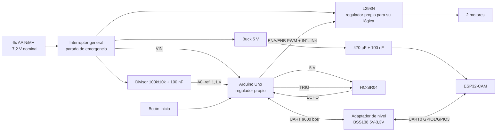
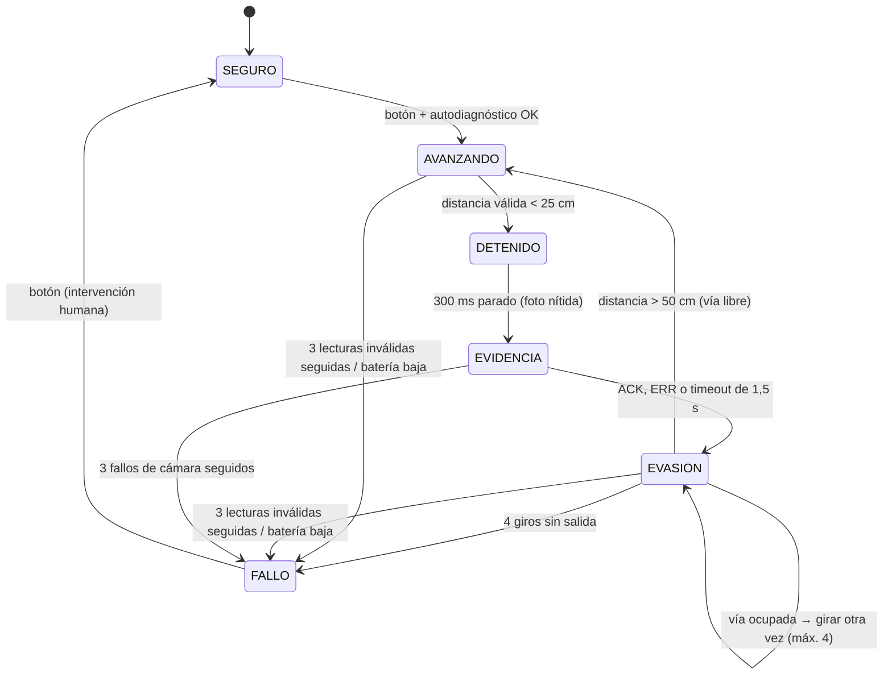

# Teslaneitor — Fase 3: Arquitectura del sistema

> Estado: **BORRADOR, pendiente de aprobación.** Diseño en papel: nada está montado ni simulado.
> Base: decisiones D-04 a D-08 (`fase-1-integracion-kit.md`) y hallazgos H1–H6 (`fase-2-especificaciones.md`).
> Fecha: 2026-10-26

---

## 1. Diagrama de bloques (actualizado)



**Masa común:** la batería, el L298N, el Uno, el buck, la ESP32-CAM y el adaptador de nivel van unidos. El adaptador de nivel necesita además las dos tensiones de referencia: LV = 3,3 V (pin 3V3 de la ESP32-CAM) y HV = 5 V (pin 5V del Uno).

**Separación de alimentaciones:** los motores toman la corriente directamente de la batería a través del L298N. El Uno y la ESP32-CAM tienen cada uno su propio regulador. Un pico de corriente de los motores baja la tensión de la batería, pero mientras se mantenga por encima de ~6,2 V (VIN del Uno) y de ~6 V (entrada del buck), la lógica no se reinicia. **[VERIFICAR en T4.]**

---

## 2. Asignación de pines

Los pines del kit original no condicionan este diseño: el firmware será nuevo y el cableado se rehará siguiendo esta tabla.

### 2.1 Arduino Uno

| Pin | Señal | Dirección | Notas |
|---|---|---|---|
| D0 / D1 | USB serie (programación y depuración) | — | **Libres**: así se puede programar sin desconectar nada. |
| D2 | RX ← ESP32-CAM | Entrada | SoftwareSerial, a través del adaptador de nivel. |
| D3 | TX → ESP32-CAM | Salida | SoftwareSerial, a través del adaptador de nivel. |
| D4 | Botón de inicio | Entrada | `INPUT_PULLUP`; el botón va a GND. |
| D5 | ENA (PWM motor izquierdo) | Salida | **Pull-down de 10 kΩ a GND** (estado seguro durante el reset). |
| D6 | ENB (PWM motor derecho) | Salida | **Pull-down de 10 kΩ a GND**. |
| D7 / D8 | IN1 / IN2 (sentido izq.) | Salida | |
| D9 / D10 | IN3 / IN4 (sentido der.) | Salida | |
| D11 | ECHO ← HC-SR04 | Entrada | 5 V: compatible directamente. |
| D12 | TRIG → HC-SR04 | Salida | |
| D13 | LED de estado (integrado) | Salida | Códigos de parpadeo por estado. |
| A0 | Tensión de batería | Entrada analógica | Divisor 100k/10k, referencia interna de 1,1 V. |
| A1–A5 | Libres | — | Reserva (p. ej. un segundo sensor en v1.1). |

> **¿Por qué D5/D6 para el PWM?** Son pines PWM del temporizador 0 (~980 Hz). SoftwareSerial no usa temporizadores, así que no hay conflicto. Los pines D9/D10 quedan como digitales normales.

### 2.2 ESP32-CAM (AI-Thinker)

| GPIO | Uso | Notas |
|---|---|---|
| GPIO1 (U0TXD) / GPIO3 (U0RXD) | UART hacia el Uno | Es el mismo puerto que el de programación: se programa en la placa ESP32-CAM-MB y después se monta en el vehículo. Al arrancar, la ROM imprime mensajes a 115200 bps; el Uno los ignora hasta recibir `READY`. |
| GPIO2, 14, 15 | microSD en **modo 1 bit** | El modo 1 bit libera GPIO4/12/13 y evita que el LED de flash (GPIO4) parpadee con los datos. |
| GPIO0, 2, 12, 15 | Strapping (H6) | Nada externo conectado. |
| GPIO4 | LED de flash | Apagado en v1. |
| Pines de la cámara | Fijos en la placa | Definidos por el diseño de AI-Thinker (B9). |

---

## 3. Protocolo UART Uno ↔ ESP32-CAM

Texto ASCII, una línea por mensaje (terminada en `\n`), 9600 bps 8N1. Es legible con cualquier monitor serie, lo que facilita la depuración.

| Sentido | Mensaje | Significado |
|---|---|---|
| CAM → Uno | `READY,<ntp_ok>` | Cámara y SD inicializadas; `ntp_ok` = 1 si hay hora real. |
| Uno → CAM | `BOOT,<causa_reset>` | Se registra por qué se reinició el Uno (RF-10). |
| Uno → CAM | `EVT,<seq>,<dist_cm>,<estado>,<bat_mV>` | Evento de obstáculo: tomar foto y registrar. |
| Uno → CAM | `LOG,<seq>,<estado>,<codigo>,<bat_mV>` | Evento sin foto (fallo, batería baja). |
| CAM → Uno | `ACK,<seq>,<archivo>` | Foto y registro correctos. |
| CAM → Uno | `ERR,<seq>,<codigo>` | `CAM` (fallo de captura), `SD` (fallo de escritura). |

- `seq` es un contador: permite emparejar cada respuesta con su evento y detectar mensajes perdidos.
- Las líneas mal formadas se descartan; el emisor lo trata como un timeout.
- **Timeout de `ACK`/`ERR`: 1,5 s.** Si no llega respuesta, el Uno lo cuenta como "sin foto" y sigue con el robot detenido hasta terminar el estado.
- `shortcut: sin checksum; añadir CRC-8 si en T5 aparecen líneas corruptas.`

---

## 4. Formato del registro (`/log.csv` en la microSD)

```
fecha_hora,uptime_ms,seq,tipo,distancia_cm,estado,bateria_mV,foto,resultado
2026-11-10T10:15:02,183422,7,EVT,23,DETENIDO,7150,/img/20261110_101502_7.jpg,OK
SIN_HORA,1203,0,BOOT,,SEGURO,,,"POWER_ON"
```

- `fecha_hora` viene del NTP; si no hay sincronización: `SIN_HORA` (D-03).
- Cada línea se escribe y se cierra (`flush`) en el momento del evento (RNF-09).
- Las fotos se guardan como `/img/AAAAMMDD_HHMMSS_<seq>.jpg`, o como `/img/up<uptime>_<seq>.jpg` si no hay hora.

---

## 5. Máquina de estados del Uno (detallada)



| Estado | Motores | Qué hace |
|---|---|---|
| SEGURO | Parados (EN = 0) | Estado al arrancar. Autodiagnóstico: una lectura válida del sensor, batería por encima del umbral y `READY` de la cámara. |
| AVANZANDO | Adelante, PWM calibrado (≤ 0,3 m/s) | Mide cada 60 ms (B5). |
| DETENIDO | Freno activo | Freno = IN1 = IN2 con EN = 1: cortocircuita el motor, que frena antes que dejándolo libre. |
| EVIDENCIA | Parados | Envía `EVT` y espera la respuesta. |
| EVASION | Atrás un tramo corto (~10 cm), luego giro por tiempo (~90°) | Mide al terminar cada giro. |
| FALLO | Parados (EN = 0) | El LED parpadea con un código; envía `LOG`. Solo sale con el botón. |

**Parámetros iniciales** (todos se ajustarán con datos de T1/T2): umbral de parada 25 cm; umbral de vía libre 50 cm; ciclo de medida 60 ms; batería baja < 6,6 V (≈ 1,1 V por celda) [SUPUESTO], con varias lecturas seguidas para no reaccionar a las caídas momentáneas al arrancar los motores.

> **Concepto — histéresis:** se para a 25 cm, pero solo se reanuda si hay más de 50 cm. Con un único umbral, un obstáculo justo a 25 cm haría que el robot arrancara y parara sin fin.
>
> **Concepto — latencia (RNF-01):** se para con la **primera** lectura válida por debajo del umbral, sin promediar. Un falso positivo solo provoca una parada innecesaria, que es el fallo "seguro". Promediar 3 lecturas añadiría ~120 ms.

---

## 6. Análisis de fallos (diseño)

| Fallo | Cómo se detecta | Respuesta | Requisito |
|---|---|---|---|
| HC-SR04 desconectado o roto | El ECHO nunca sube tras el disparo | Lectura inválida → FALLO tras 3 seguidas | RF-07 |
| Sin obstáculo dentro del rango | El ECHO sube pero el pulso es largo | Se trata como "vía libre", **no** como error | RF-02 |
| Cámara o SD fallan | `ERR` o timeout | Evento sin foto; FALLO tras 3 seguidos | RF-08 |
| ESP32-CAM sin respuesta al arrancar | No llega `READY` | Se queda en SEGURO (no arranca) | RF-08 |
| Batería baja | Lectura de A0 filtrada | FALLO + `LOG` | RF-09 |
| Reinicio del Uno (brown-out, watchdog) | Registro MCUSR al arrancar | Motores parados por los pull-down; `BOOT,<causa>` | RF-10 |
| Bloqueo del firmware del Uno | Watchdog (~0,5 s) | Reinicio → SEGURO | RF-10 |
| Pánico humano | Interruptor general | Corta toda la alimentación | RF-11 |

**Supuestos a comprobar en T1:** distinguir "sensor desconectado" de "sin obstáculo" se basa en que un HC-SR04 que funciona *siempre* sube el ECHO tras el disparo, aunque no reciba eco (pulso largo, ~38 ms en muchos clones). Esto **no** está en el datasheet (B5): es [SUPUESTO]. Si T1 lo desmiente, la detección de sensor desconectado se hará con una resistencia pull-down en ECHO y un timeout más corto.

**Riesgo nuevo — watchdog en clones:** algunos clones del Uno llevan un bootloader antiguo que no desactiva el watchdog tras un reinicio, y la placa queda en un bucle de reinicios. Se comprobará en T0 con un programa de prueba antes de usar el watchdog en el firmware. [SUPUESTO conocido en la comunidad; no tiene fuente primaria.]

---

## 7. Decisiones aprobadas (2026-10-26)

| ID | Decisión |
|---|---|
| D-09 | Mapa de pines del Uno y de la ESP32-CAM (sección 2). |
| D-10 | Protocolo UART y formato del registro (secciones 3 y 4). |
| D-11 | Si la cámara falla en marcha, el robot sigue sin fotos y pasa a FALLO tras 3 fallos seguidos. |
| D-12 | Parámetros iniciales: parada a 25 cm, vía libre a 50 cm, ciclo de 60 ms, batería baja < 6,6 V. |
